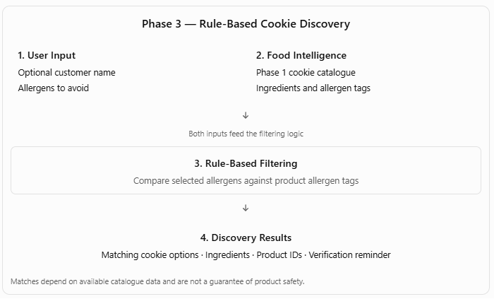

# Phase 3 — Abundance: Rule-Based Cookie Discovery

**A user-facing MVP for exploring cookie products against selected allergen restrictions.**

[**Try the live application »**](https://akshyapatra-rulebased.streamlit.app/)

## 1. Overview

Phase 3 brings the Phase 1 Food Intelligence output into a user-facing Streamlit application.

The current MVP allows users to select allergens they wish to avoid and explore cookie products from the Phase 1 catalogue. A deterministic, rule-based filter compares the selected allergens against the allergen tags associated with each product.

The objective of this phase is to demonstrate how product-level Food Intelligence can support a practical food discovery experience.

**Current scope:** Rule-Based Cookie Discovery MVP. This is an initial application, not yet the complete personalized Recommendation Engine described in the Akshaya Patra conceptual architecture.

## 2. MVP Workflow



The application brings together two inputs:

- **User selections:** Optional customer name and allergens the user wishes to avoid.
- **Food Intelligence:** Product information, ingredients, and allergen tags from the Phase 1 cookie catalogue.

The rule-based filtering logic compares these inputs and displays products that do not have the selected allergens recorded in their allergen tags.

## 3. Current Application Capabilities

The Streamlit application currently supports:

- Optional customer name entry.
- Selection of allergens to avoid.
- Rule-based filtering of the cookie catalogue.
- Display of the total number of products and matching results.
- Adjustable number of results displayed.
- Product names and brand information, where available.
- Ingredient lists and USDA FoodData Central product IDs.
- A reminder to verify the physical product packaging before consumption.

The application displays products in catalogue order. It does not currently calculate recommendation scores or rank products by customer preference.

## 4. Food Intelligence Input

The application consumes the Phase 1 output:

`data/CookieIntelligence.csv`

The catalogue contains **13,308 cookie product records** from the USDA FoodData Central Branded Foods dataset, filtered to the Cookies & Biscuits category.

The current application supports filtering against seven allergen categories:

- Milk
- Eggs
- Wheat
- Sesame
- Peanuts
- Tree Nuts
- Soybeans

Fish and Crustacean Shellfish are not currently evaluated by this cookie-focused implementation.

Phase 1 remains the source of product and allergen information. Product records are not synthetically generated in Phase 3.

## 5. Relationship to Customer Intelligence

The current application uses direct user selections rather than customer profiles generated through Phase 2.

The Phase 2 Customer Intelligence workstream is being explored separately. Its planned customer profiles, household information, and shopping histories are not yet integrated into this application.

Future development can explore connecting Customer Intelligence with Food Intelligence to support more personalized product discovery.

## 6. Current Scope and Limitations

The current MVP is deterministic and rule-based. It does not yet include:

- Synthetic customer profile integration.
- Household-level recommendation logic.
- Shopping-history analysis.
- Machine Learning or NLP-based recommendations.
- Personalized recommendation scoring or ranking.
- AI agent-based capabilities.

**Food-safety limitation:** A product shown as a match means that none of the user's selected allergens were detected in the product's available allergen tags. It does not establish that the product is safe for consumption.

The underlying ingredient and allergen data may be incomplete or incorrectly classified. The current application also treats missing or unparseable allergen-tag data as an empty allergen list, which requires further validation. Always inspect the physical product packaging and ingredient declaration before consumption.

The application is an educational MVP prototype and does not provide medical or dietary advice.

## 7. Application and Technology

| Component | Technology |
|---|---|
| User interface | Streamlit |
| Application logic | Python |
| Data processing | Pandas |
| Product catalogue | Phase 1 CSV output |
| Allergen filtering | Deterministic rule-based logic |

### Project Structure

```text
Phase3_Abundance/
│
├── README.md
├── streamlit_app.py
├── requirements.txt
│
├── data/
│   └── CookieIntelligence.csv
│
└── Phase3_MVP_Workflow.png
```

### Run Locally

From the `Phase3_Abundance` directory:

```bash
pip install -r requirements.txt
streamlit run streamlit_app.py
```

## 8. Application Screenshots

*Screenshots of the deployed application will be added here.*

They will illustrate the user input, allergen selection, product results, and ingredient details.

## 9. Future Direction

The current MVP establishes an initial user-facing experience using Phase 1 Food Intelligence.

Future development can explore the integration of Customer Intelligence, more advanced recommendation logic, and personalized food discovery as the other project capabilities mature.

The long-term direction is to bring Food Intelligence and Customer Intelligence together through a Recommendation Engine, as described in the Akshaya Patra conceptual system architecture.
